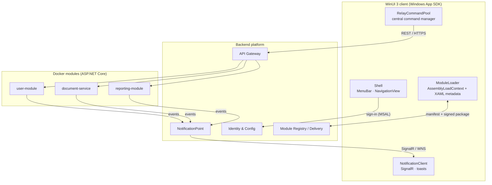
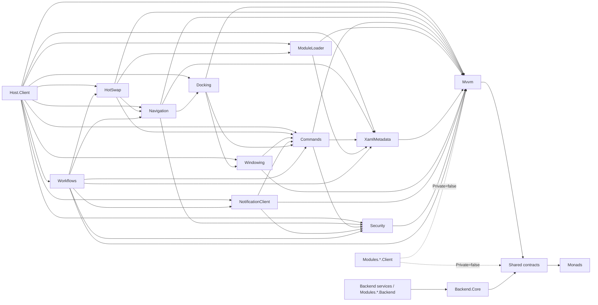
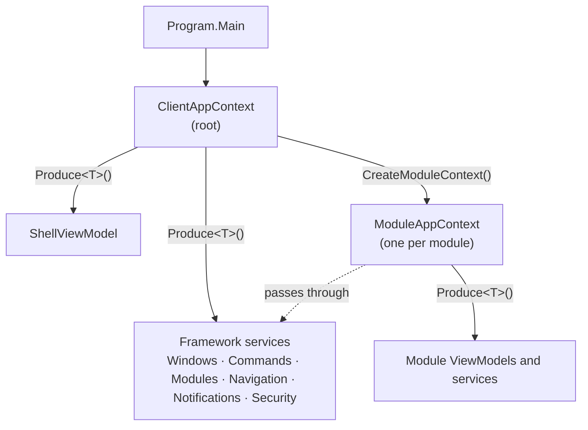
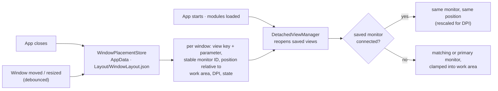
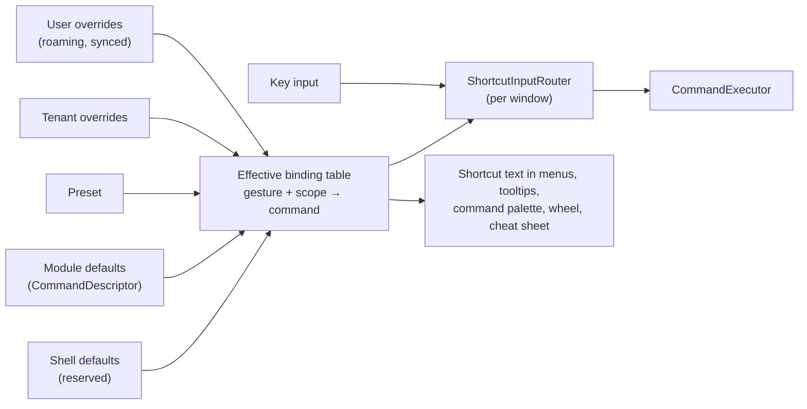
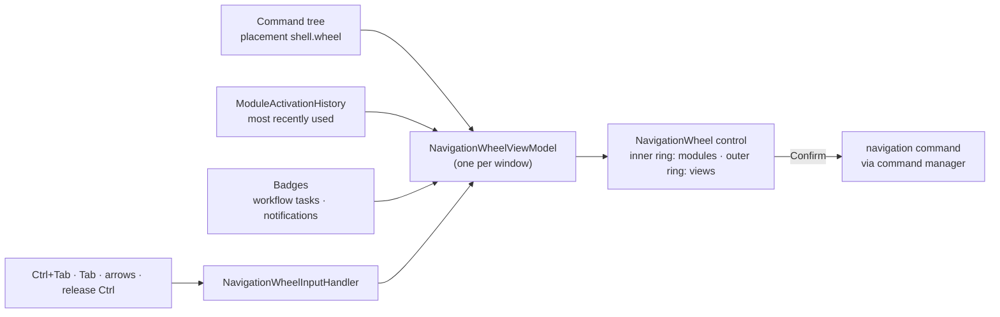
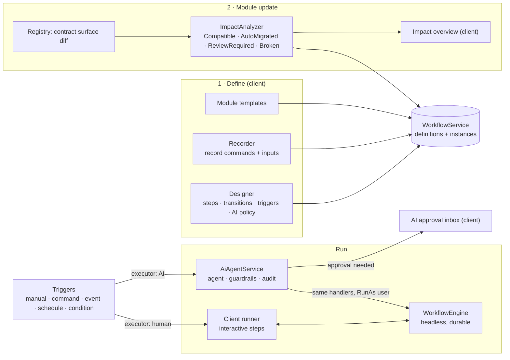
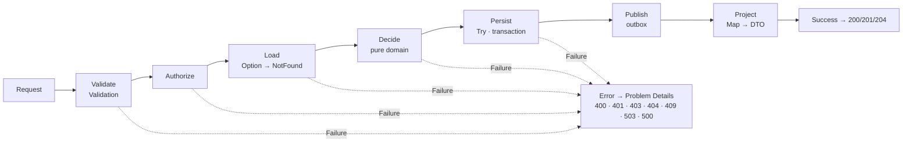

# GoldenHive.NET.WinUI.Framework – Architecture

Modular, server-driven WinUI 3 framework on **.NET 10 (LTS)** and the Windows App SDK:
self-written MVVM on an application context (AppContext architecture) + central command manager (RelayCommandPool) + hot-swap + NotificationPoint +
dynamic module delivery + Docker microservices + workflows that users design in the app and AI can execute.

> **Status:** stage 1 implemented – runnable client shell. The parts listed below contain real
> code; every other source file is still a **comments-only** blueprint for its implementation.
>
> | Project | Implemented |
> |---|---|
> | Shared/CommandContracts | `KeyGesture`, `ShortcutScope`/`ShortcutBinding`, `CommandPlacement`, `CommandGroupDescriptor`, `CommandDescriptor`, `ICommandHandler`, `CommandTreeNode` |
> | Shared/ModuleContracts | `ViewDescriptor` (`ViewRole`, `DockSide`) |
> | Client/Mvvm | `ApplicationContext`, `AppObject`, `ViewModelAppObject`, `LogManager`, `LanguageManager`, `LocalizedText`, `JsonController`, size classes |
> | Client/XamlMetadata | `IconCatalog` |
> | Client/Commands | `RelayCommandPool` with `CommandDispatcher`, registry, executor, tree builder, `ShortcutManager`, `ShortcutInputRouter`, `gh:Ui` attached properties, rich tooltips |
> | Client/Windowing | `WindowManager`, `WindowPlacementStore`, `ResponsiveLayoutManager` |
> | Client/Docking | `DockManager`, `DockHost`, tool panes, splitters, `FloatingDockWindow`, `DockLayoutStore` |
> | Client/Navigation | `NavigationRegistry`, `NavigationService`, activation history, navigation wheel |
> | Client/Host.Client | `ClientAppContext`, shell commands, built-in views, shell UI (title bar, menu, palette, dock area, status bar) |
>
> Next stages: drag-and-drop docking guides, module loading, backend.

## Overview

The system has three areas:

1. **WinUI client** – a long-running host app that loads feature modules from the server at runtime.
2. **Central backend platform** – manages modules, users, permissions, updates and notifications.
3. **Docker modules** – independent ASP.NET Core services holding each feature's business logic.
4. **Workflows** – multi-step input flows designed in the app, analysed on every module update and
   executable by people or by an AI agent on triggers.



A feature consists of two artifacts: a **client package** (WinUI class library, signed ZIP, loaded at
runtime) and a **backend container**. A client module is never a Docker container itself.

## Solution structure

The solution `GoldenHiveFramework.slnx` groups the projects into solution folders.

| Folder | Project | Type | Purpose |
| --- | --- | --- | --- |
| `Client/` | `GoldenHive.NET.WinUI.Framework.Host.Client` | WinUI app (MSIX) | ClientAppContext, custom `Main`, shell, startup, activation, XAML metadata bridge |
| | `…Mvvm` | WinUI library | Application context, AppObject, ViewModelAppObject, log, languages, JSON persistence |
| | `…Commands` | WinUI library | Central command manager incl. the UI dispatcher and the shortcut manager, command trees, menu adapters |
| | `…ModuleLoader` | WinUI library | Catalogue, download, validation, load contexts, local store |
| | `…XamlMetadata` | WinUI library | Aggregated `IXamlMetadataProvider`, loose-XAML views, module resources, icon catalogue |
| | `…HotSwap` | WinUI library | Module swap, quiescence, unload monitoring |
| | `…Navigation` | WinUI library | Navigation service, registry, view locator, navigation wheel (Ctrl+Tab) |
| | `…Docking` | WinUI library | Visual Studio-style dock layout: document well, tool windows, auto-hide, floating windows, dock guides, saved layouts |
| | `…Windowing` | WinUI library | WindowManager, responsive layout (size classes), detachable views, window placement per monitor in AppData |
| | `…NotificationClient` | WinUI library | SignalR, in-app, toast and push notifications |
| | `…Security` | WinUI library | Sign-in (MSAL/WAM), permissions, token storage |
| | `…Workflows` | WinUI library | Workflow runner, designer, recorder, inbox, impact overview, AI approval inbox |
| `Shared/` | `…Monads` | .NET 10 library | Self-written monads: `Result`, `Option`, `Validation`, `Error`, `Try`, async + LINQ extensions |
| | `…Contracts` | .NET 10 library | Base types, error model |
| | `…ModuleContracts` | .NET 10 library | Module entry point, context, manifest model, compatibility |
| | `…CommandContracts` | .NET 10 library | Command IDs, descriptors, placements, tree nodes, handlers |
| | `…NotificationContracts` | .NET 10 library | Notification envelope, event types |
| | `…WorkflowContracts` | .NET 10 library | Workflow definitions, steps, input schemas, triggers, instances, impact reports, AI policy |
| `Backend/` | `…Backend.Core` | ASP.NET Core library | Monad architecture for all backends: use-case pipeline steps, `ResultHttpMapper`, exception boundary |
| | `…Backend.ApiGateway` | ASP.NET Core | Single public entry, routing (YARP), TLS, rate limiting |
| | `…Backend.IdentityService` | ASP.NET Core | Authentication, roles, permissions |
| | `…Backend.ModuleRegistryService` | ASP.NET Core | Modules, versions, enablement, compatibility |
| | `…Backend.ModuleDeliveryService` | ASP.NET Core | Signed package storage and download |
| | `…Backend.UpdateOrchestrator` | ASP.NET Core | Staged rollouts, hot-swap vs. restart, rollback |
| | `…Backend.NotificationPoint` | ASP.NET Core | SignalR hub, event bus consumer, outbox, WNS |
| | `…Backend.ConfigurationService` | ASP.NET Core | Global/tenant/role/user settings, AI model profiles |
| | `…Backend.WorkflowService` | ASP.NET Core | Workflow storage, server-side engine, triggers, impact analysis, migrations |
| | `…Backend.AiAgentService` | ASP.NET Core | AI execution of workflows: agent, tool catalogue, guardrails, audit log |
| `Modules/<Feature>/` | `GoldenHive.NET.Modules.<Feature>.Client` | WinUI library | Module entry point, ViewModels, views |
| | `GoldenHive.NET.Modules.<Feature>.Backend` | ASP.NET Core | Feature API as Docker container |
| | `manifest.jsonc` | – | Module manifest (client package + backend service) |
| `Deployment/` | – | Solution items | Docker Compose, Kubernetes, CI/CD, MSIX, package format |

Example features: **UserManagement**, **DocumentManagement**, **Reporting**.

### Project references



- Module clients reference contracts with `Private=false`, so the contracts are not copied into the
  module package and are shared through the host's default load context.
- Backend projects build as `Library` until their `Program.cs` is implemented (see the note in each `.csproj`).

## Application context (AppContext architecture)

The MVVM layer is self-written and follows the AppKontext architecture of
[WIFI.Anwendung](https://github.com/zenoxart/WIFI.CS.2021/tree/master/WIFI.Anwendung), in English and adapted to WinUI 3.

| WIFI.Anwendung | Golden Hive | Role |
| --- | --- | --- |
| `IAppKontext` | `IAppContext` | "has an application context" |
| `AppKontext` | `ApplicationContext` | Infrastructure + object factory `Produce<T>()`, lazy services, paths, reference to the UI dispatcher |
| `AppObjekt` | `AppObject` | Base of all services; `ErrorOccurred` event (rethrown in DEBUG if unhandled) |
| `ViewModelAppObjekt` | `ViewModelAppObject` | Base of all ViewModels; `INotifyPropertyChanged`, `IsBusy` counter, `BeginWork`/`EndWork` logging |
| `DatenbankAppKontext` | `ClientAppContext` (host) | Adds all framework services (Windows, Commands, Modules, Navigation, …) |
| – | `ModuleAppContext` | Child context per module; tracks everything a module registers and releases it on unload |
| `FensterManager` | `WindowManager` | Window positions per monitor setup |
| `ProtokollManager` | `LogManager` | Application log |
| `SprachenManager` | `LanguageManager` | Application languages |
| `XmlController<T>` | `JsonController<T>` | Typed persistence |



- `Program.Main` (custom entry point, `DISABLE_XAML_GENERATED_MAIN`) creates the root `ClientAppContext`
  before the WinUI `Application` starts.
- Objects are never created with `new`: `Produce<T>()` sets the context, attaches the error handler
  and writes a log entry. Derived contexts extend production by overriding it.
- The UI dispatcher belongs to the central command manager (`RelayCommandPool.Dispatcher`). Mvvm only defines
  the `IUiDispatcher` contract; the `ClientAppContext` points `ApplicationContext.Dispatcher` at the pool's instance.
- The class is named `ApplicationContext` instead of `AppContext` to avoid a clash with `System.AppContext`.

## Central command manager

The `RelayCommandPool` is the single command manager of the application and replaces WPF's
`CommandManager`, which does not exist in WinUI.

| Responsibility | Description |
| --- | --- |
| Registration | Commands and groups per module; bulk unregister on unload, atomic replace on hot-swap |
| Lookup | One stable `PooledCommand` per command ID, also before the module has loaded |
| State | CanExecute, visibility, checked state; requery through the pool's dispatcher |
| UI dispatching | Owns the application's `CommandDispatcher` (one `DispatcherQueue` per window); all UI-facing changes go through it |
| Execution | Through `CommandExecutor`, also for shortcuts, command palette and deep links |
| Command trees | `GetTree(placement, context)` for menus and tree views; `TreeChanged` event |
| Search | Flat search with breadcrumb path for a command palette |
| Shortcuts | `ShortcutManager` (see below): layered bindings, scopes, conflicts, input routing |

**Command trees.** Each command declares *placements*: the menu (`shell.mainmenu`,
`shell.navigation`, `context.document`, …), the path inside it (`file/export`), a section and an
order. The `CommandTreeBuilder` merges all registrations into one tree per placement: it creates
missing groups, merges contributions from several modules, applies permissions, sorts, inserts
separators, expands dynamic children (`ICommandTreeProvider`) and removes empty groups.
`CommandTreeAdapters` project the tree onto `MenuBar`, `MenuFlyout`, `TreeView`, `NavigationView`
and `CommandBar`. Leaves bind to the stable `PooledCommand`, so menus survive a hot-swap; on
changes the adapters patch the control by node ID and keep expansion and selection.

Navigation targets are registered as `navigate.<key>` commands, so the navigation tree is just
another command tree.

## Responsive layout and detachable views

**Responsive first.** Every view adapts to the space it actually gets – in the main window, in a side pane or
detached in its own window – not to the screen size.

| Size class | Available width | Typical layout |
| --- | --- | --- |
| Compact | < 640 epx | One column, navigation as hamburger, panels as overlays, touch-sized targets |
| Medium | 640–1007 epx | Two columns where useful, navigation as icon pane |
| Expanded | 1008–1919 epx | Full layout, navigation pane open, side panels docked |
| Wide | ≥ 1920 epx | Extra columns, master–detail side by side, max line length kept |

The `ResponsiveLayoutManager` (one per window) computes the class per layout host with hysteresis, sets the
visual states (`Compact`/`Medium`/`Expanded`/`Wide`) and pushes `SizeClass` into the ViewModels
(`IResponsiveView`). It also reacts to DPI changes, text scaling and minimum window sizes. Views use no fixed
sizes; workflow forms flow into 1–3 columns.

**Detachable views.** Any view can be torn off into its own window (`Ctrl+Shift+D`, header button, or drag) and
attached back (`Ctrl+Shift+A`). The view is recreated in the new window with the **same ViewModel instance**, so no
state is lost. Detached views appear in the navigation wheel and survive module hot-swaps.



- Stored in **AppData** (`LocalDataPath\Layout\WindowLayout.json`; packaged apps: `…\Packages\<family>\LocalState`),
  local rather than roaming because monitor setups differ per machine.
- Monitors are identified by a stable monitor ID (not the per-session `DisplayArea` ID), with resolution and
  arrangement as fallback; windows are never restored off-screen.

## Icons, texts and tooltips

Every button gets an icon and a localized tooltip with one attribute, and no visible text is hard-coded.

```xml
<!-- bound to a command: icon, label, tooltip, shortcut, disabled reason and accessibility text come from the command -->
<AppBarButton gh:Ui.Command="documents.approve" />

<!-- without a command -->
<Button gh:Ui.Icon="save" gh:Ui.Text="shell:common.save" gh:Ui.ToolTip="documents:invoice.tooltip.save" />
```

| Piece | Where | Role |
| --- | --- | --- |
| `IconRef` | Contracts | Icon by symbolic name (`save`, `documents.invoice`, `glyph:E74E`, `image:…svg`) |
| `TextKey` | Contracts | Text by key (`<scope>:<key>`); a command needs one key, `.label` / `.tooltip` / `.description` / `.disabled.<reason>` follow by convention |
| `IconCatalog` | XamlMetadata | Resolves names to Segoe Fluent Icons glyphs or module SVG/PNG; theme- and high-contrast-aware |
| `LanguageManager` / `LocalizedText` | Mvvm | Text lookup with fallback (de-AT → de → module default → en), live language switch without restart, pseudo-localization |
| `gh:Ui.*` attached properties | Commands | One-line icons, texts and tooltips in host and module XAML (also loose XAML) |
| `RichToolTipBuilder` | Commands | Standard tooltip: **label + shortcut**, description, disabled reason |

Tooltip example (German UI): **Freigeben** `Strg+Umschalt+F` · *Rechnung zur Buchung freigeben* · *Keine Berechtigung* (only when disabled).

- Menus, the navigation wheel, tabs and tool window headers get icons and tooltips automatically from the commands.
- Modules ship their texts per language and their own icons; CI fails on missing keys or unknown icon names.

## Dock layout (Visual Studio style)

The main window uses a self-written dock layout modelled on Visual Studio Community (WinUI 3 has no docking control).

```
+-----------------------------------------------------------------+
| Title bar (search, account)  ·  Menu bar  ·  Toolbar            |
+--+--------------+--------------------------------+-----------+--+
|A | Module       |  Document well                 | Properties|A |
|u | Explorer     |  [Tab][Tab][Tab]   |  [Tab]    | / module  |u |
|t | (tool window)|  tab group 1       |  group 2  | tool      |t |
|o |              +--------------------+-----------+ windows   |o |
|- |              | Output · Notifications · Workflow inbox    |- |
|hide             |            (tabbed bottom pane)            |hide
+--+--------------+--------------------------------------------+--+
| Status bar                                                      |
+-----------------------------------------------------------------+
```

| Element | Behaviour |
| --- | --- |
| Document well | Views with role *Document* open as tabs; tab groups split horizontally/vertically; pinned tabs; dirty markers |
| Tool windows | Views with role *ToolWindow* dock left/right/top/bottom, share panes as tabs, can be hidden (Shift+Esc) |
| Auto-hide | Unpinned tool windows collapse to edge tabs and slide in as flyouts |
| Floating | Tabs and tool windows tear off into floating windows (= detachable views) that can hold their own tab groups |
| Dock guides | While dragging, a VS-style diamond and edge guides show where the item will dock (Ctrl suppresses docking) |
| Layouts | Saved automatically in AppData (`Layout\DockLayout.json`); named layouts: save, apply, reset |
| Responsive | Medium: side panes auto-hide · Compact: one document with a tab dropdown, tool windows as flyouts – the saved layout is untouched |

- Modules declare a `ViewDescriptor` per view (role, default dock side, size, multiple instances, can close/float).
- Navigation opens views through the `DockManager`; an already open view is activated instead of reopened.
- Floating windows reuse the detachable-view mechanism, so their monitor and position are restored from AppData.
- After a hot-swap, tabs stay in place and their content is rebuilt; tabs of missing modules stay as placeholders.
- VS-style shortcuts: Ctrl+F4, Ctrl+F6 / Ctrl+Shift+F6, Shift+Esc, Alt+-, Alt+Shift+Enter, Ctrl+- / Ctrl+Shift+-;
  Ctrl+Tab remains the navigation wheel, which also lists open documents and tool windows.

## Shortcut manager

All keyboard shortcuts are managed by the `ShortcutManager`, which lives inside the central command manager
(`RelayCommandPool.Shortcuts`): every shortcut is bound to a command ID.



- **Gestures:** single (`Ctrl+S`), chords (`Ctrl+K, Ctrl+D`) and hold gestures (`Ctrl+Tab` for the navigation wheel);
  stored by virtual key so they work on every keyboard layout, displayed localized ("Strg+Umschalt+P").
- **Scopes:** Focus > View > Module > Window > Global; plain keys never fire while a text field has focus.
- **Conflicts:** detected on every rebuild; modules can never take reserved shell shortcuts; module-vs-module
  conflicts are listed for the user to resolve.
- **Survives updates:** user overrides are keyed by command ID, so they survive hot-swaps and module updates.
- **UI:** shortcut settings page (search, record by pressing keys, presets, reset, import/export) and a
  cheat sheet overlay showing the shortcuts available right now.

| Reserved shell shortcut | Action |
| --- | --- |
| Ctrl+Tab / Ctrl+Shift+Tab (hold) | Navigation wheel |
| Ctrl+Shift+P | Command palette |
| Ctrl+K, Ctrl+S | Shortcut settings |
| Ctrl+/ or hold Ctrl ~1 s | Shortcut cheat sheet |
| F1 | Help for the current view |
| Esc | Close overlay / cancel |

## Navigation wheel

Holding **Ctrl+Tab** opens a radial **navigation wheel** over the current window to switch between
modules and jump into their views – with Alt+Tab semantics.



| Input | Effect |
| --- | --- |
| Ctrl+Tab (hold) | Open the wheel, previous module preselected |
| Tab / Shift+Tab | Next / previous segment |
| Arrow keys | Move around the ring; Right/Left drill into / out of a module's outer ring |
| Release Ctrl or Enter | Navigate to the selection |
| Esc | Cancel |
| Quick tap Ctrl+Tab | Jump straight back to the previous module, without showing the wheel |
| Mouse / touch / gamepad | Point at a segment and click / tap / release |

- **Dynamic:** the wheel is the command tree for placement `shell.wheel`. Every loaded module contributes its
  home target (inner ring) and optionally more views under `shell.wheel/<moduleId>` (outer ring). It follows
  module loads, unloads, hot-swaps and permission changes automatically.
- **Ordered by use:** the inner ring is sorted most-recently-used first, kept per window and across restarts.
- **Reserved shortcut:** Ctrl+Tab and Ctrl+Shift+Tab belong to the shell; modules cannot claim them. The keys are
  caught in `PreviewKeyDown`/`PreviewKeyUp` on the window root, so controls such as `TabView` do not swallow them.
- **Accessible:** full keyboard operation, UI Automation list semantics for Narrator, reduced motion and high contrast.

## Workflows and AI execution

Users define workflows **in the app** over several input interactions inside a module. Every module
update is checked against all workflows, and workflows can be run **by AI** on triggers.



**1 · Define.** A `WorkflowDefinition` is data, not code: steps (Input, Choice, Review, Command, ModuleStep,
WaitForEvent, Approval, AiTask, SubWorkflow), transitions with safe expressions, variables, triggers and an
AI policy. Forms are generated from module-owned `InputSchema`s. Workflows come from module templates, the
designer, or the recorder. Published versions are immutable; running instances keep their version and are
persisted after every step, so they resume anywhere – on another device, on the server or with the AI.

**2 · Impact of module updates.** Each module version publishes a generated, signed
`ModuleContractSurface` (commands, input schemas, step types, events, templates, migrations). The Module
Registry diffs it against the previous version; the `ImpactAnalyzer` looks up every workflow depending on
it, applies declared migrations, classifies the rest, marks broken ones *NeedsReview*, suspends their AI
triggers and decides for running instances (continue, migrate, pause). The **impact overview** in the
client lists every affected workflow per module update with reasons and actions; the Update Orchestrator
can hold a rollout stage while critical workflows would break. During a hot-swap, running instances of
the module are paused at a step boundary.

**3 · AI execution.** A trigger with executor *AI* starts the `AiWorkflowAgent`. It fills inputs as
structured output validated against the step's schema and acts only through tools generated from
workflow-capable, AI-allowed commands and step types – executed by the same headless handlers as human
runs. The `AiExecutionPolicy` sets the autonomy (Off, Suggest, ApproveCritical, ApproveEachStep,
Autonomous), allow lists, approvers, limits and data scope; Approval steps always need a human. The agent
acts on behalf of the RunAs user with exactly that user's permissions, hands over to a human when unsure,
and every action is recorded in the audit log.

## Backend code: monad architecture

All backend code – platform services and module backends – follows a self-written **monad architecture**:
expected failures are values, and every operation is a railway pipeline.



| Type | Meaning | Used for |
| --- | --- | --- |
| `Result<T>` | Success(value) or Failure(`Error`) | Every use case and step; `Map`, `Bind`, `Ensure`, `Tap`, `MapError`, `Recover`, `Match` |
| `Option<T>` | Some(value) or None | Lookups instead of `null`; `ToResult(NotFound)` |
| `Validation<T>` | Value or **all** errors | Requests and value-object smart constructors |
| `Error` | Kind (Validation, NotFound, Conflict, Forbidden, Unauthorized, Unavailable, Timeout, Unexpected), code, `TextKey`, field errors | Failures as data; sent as Problem Details (`ApiError`) |
| `Try` | Exception → `Result` | Only in adapters (database, HTTP clients) |

- **Shape of a use case:** Validate → Authorize → Load → Decide (pure, immutable, no I/O) → Persist → Publish → Project.
  Example: `Modules/DocumentManagement/Backend/UseCases/ApproveInvoice.cs`.
- **Edges only:** endpoints bind the request, call the use case and map the `Result` with the `ResultHttpMapper`;
  `Match` is only used there. Exceptions are for bugs only and end in the `ExceptionBoundaryMiddleware`.
- **One code path:** HTTP endpoints, workflow step handlers and AI tools call the same use cases, so humans, the
  workflow engine and the AI agent get identical rules and errors. The workflow engine reacts per error kind
  (retry on Unavailable/Timeout, back to the user on Validation, stop on Forbidden).
- **Async and composition:** `BindAsync`/`MapAsync` on `Task<Result<T>>`, C# query syntax for multi-value pipelines,
  `Traverse`/`Combine` for collections. Ordinary ASP.NET Core dependency injection stays for dependencies.
- **Client:** API clients turn Problem Details back into `Error`, so client code can use `Result` too and show
  the localized message from the error's `TextKey`.

## Module lifecycle

1. The host signs in and asks the Module Registry for enabled, compatible modules.
2. Missing packages are downloaded over HTTPS, hash and signature are verified.
3. Each module version is loaded into its own collectible `AssemblyLoadContext`; WinUI, the
   Windows App SDK, Mvvm and the contracts are shared with the default context. The module gets
   its own `ModuleAppContext`.
4. The module's XAML metadata provider is registered with the aggregated provider.
5. `IModuleEntryPoint.Initialize` registers services, commands (with placements), navigation
   targets, views and event subscriptions.
6. **Hot-swap:** the new version is loaded side by side, running commands are drained, ViewModel
   state is saved, views are closed, registrations are switched atomically, views are rebuilt and
   state restored. The old load context is unloaded best-effort; if WinRT/XAML references keep it
   alive, the shell recommends a restart.

Modules with `hotSwap: restartRequired`, host updates (MSIX / App Installer) and changes to the
.NET or Windows App SDK runtime or to shared contracts always require a restart.

## Core rules

1. Modules reference only the contracts in `Shared/` (and `Mvvm`), never other modules or framework internals.
2. The RelayCommandPool is the central command manager: every command is registered, executed and
   arranged in menus through it. Command IDs (`<module>.<action>`) are stable, so bindings survive a hot-swap.
3. Menus are never built by hand: the command manager generates command trees per placement.
4. Module views are built from loose XAML or in code; XAML types resolve through the aggregated metadata provider.
5. Hot-swap: activate the new version reliably, unload the old one best-effort.
6. Authorization always happens on the server; the client only hides or disables features.
7. An `AssemblyLoadContext` is not a security boundary: only signed, trusted modules are loaded.
8. No trimming and no Native AOT for the host – both break dynamic assembly loading.
9. Every service and ViewModel is an `AppObject` produced by an application context – never created with `new`.
10. Workflows are data; every step a workflow or the AI can run has a headless handler in the module backend.
11. The AI never has more permissions than the workflow's RunAs user, acts only within its policy, and every AI action is audited.
12. Every module version publishes its contract surface; breaking changes to commands, schemas or step types are detected before rollout.
13. Responsive first: every view works from 320 epx to full screen through size classes, never fixed sizes, and every view can run detached in its own window.
14. The UI is a dock layout: every view declares whether it is a document or a tool window; layouts are never hard-coded.
15. No hard-coded visible text or icon code points: texts are `TextKey`s in every supported language, icons are `IconRef` names, and buttons get icon and tooltip from their command.
16. Backend code follows the monad architecture: expected failures are `Result`/`Option`/`Validation` values, use cases are railway pipelines, domain logic is pure, and exceptions are reserved for bugs.

## Technology baseline

| Area | Choice |
| --- | --- |
| Runtime | .NET 10 (LTS, supported until November 2028) |
| Client | WinUI 3, Windows App SDK, target `net10.0-windows10.0.26100.0`, min. `10.0.17763.0` |
| MVVM | Self-written (application context architecture), no third-party MVVM library |
| Real-time | SignalR, `AppNotificationManager`, WNS (`PushNotificationManager`) |
| Sign-in | MSAL with WAM broker |
| Backend | ASP.NET Core, YARP, OpenTelemetry, health checks; self-written monads (Result, Option, Validation) |
| Hosting | Docker Compose (small), Kubernetes (scale, rolling updates) |
| Workflows | Declarative definitions, safe expression language, durable server engine |
| AI | Provider abstraction with tool calling + structured output; model profiles per tenant |
| Host delivery | MSIX + App Installer |

## Open points

- [x] **Trimming:** `PublishTrimmed` is switched off in the host `.csproj` (rule 8).
- [ ] Prototype: module view via `XamlReader.Load` + aggregated `IXamlMetadataProvider`.
- [ ] Measure whether collectible load contexts are actually unloaded after a hot-swap.
- [ ] Decide between packaged (MSIX) and unpackaged host.
- [ ] Define the signing chain for module packages.
- [ ] Choose the AI provider/model profiles and the data-residency rules per tenant.
- [ ] Define the expression language for transitions and mappings.
- [ ] Decide the durable execution store for the WorkflowEngine.
- [x] Stage 1: shared contracts, command manager, MVVM core and the runnable client shell.
