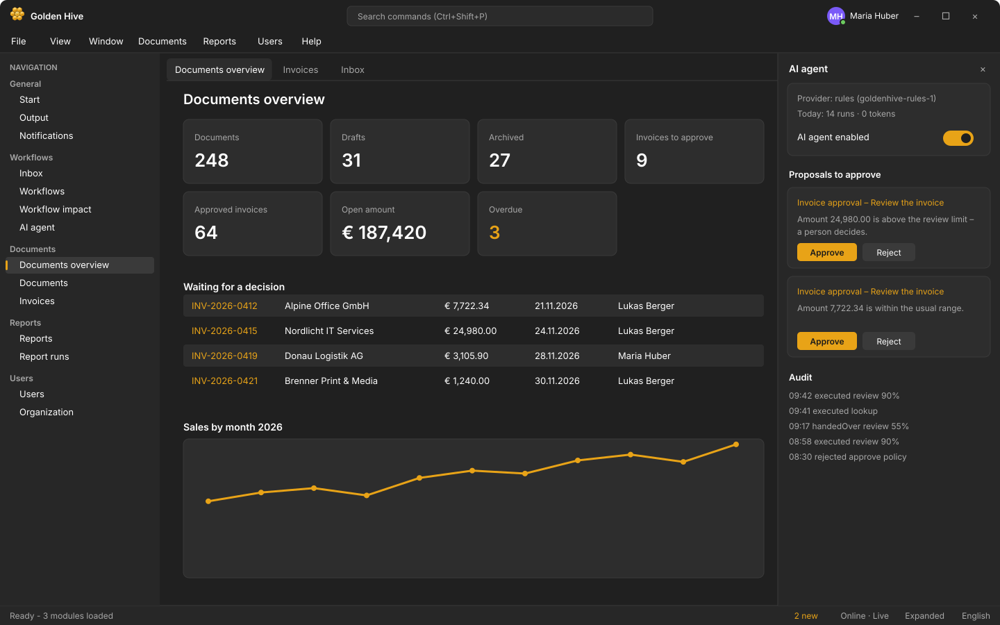
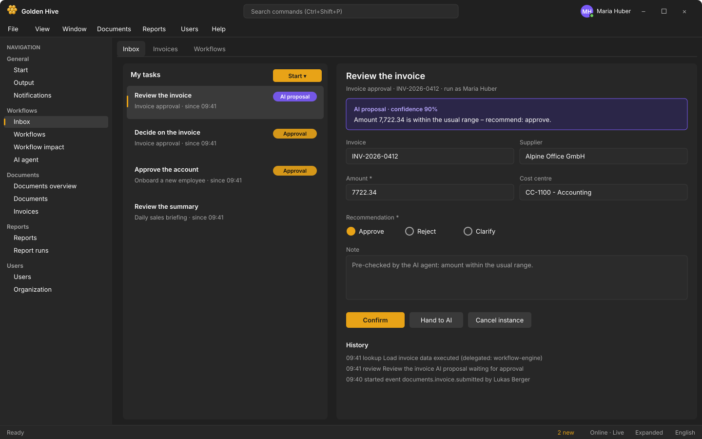
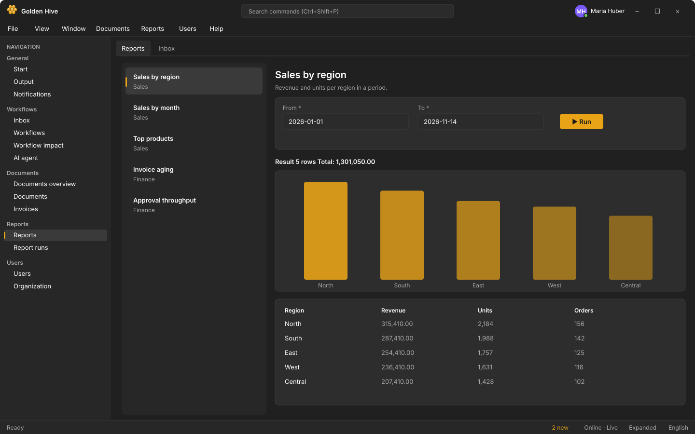
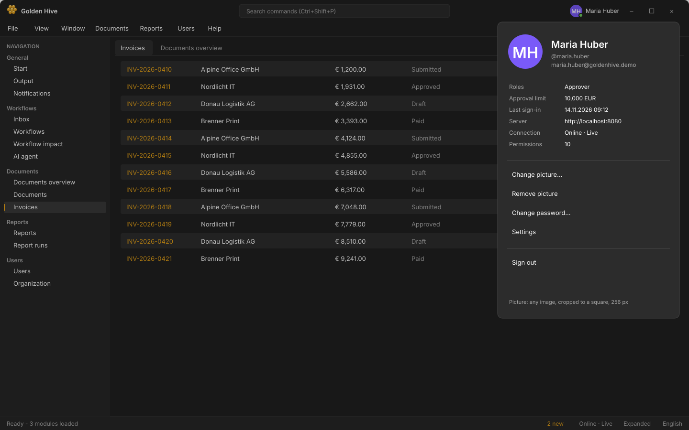
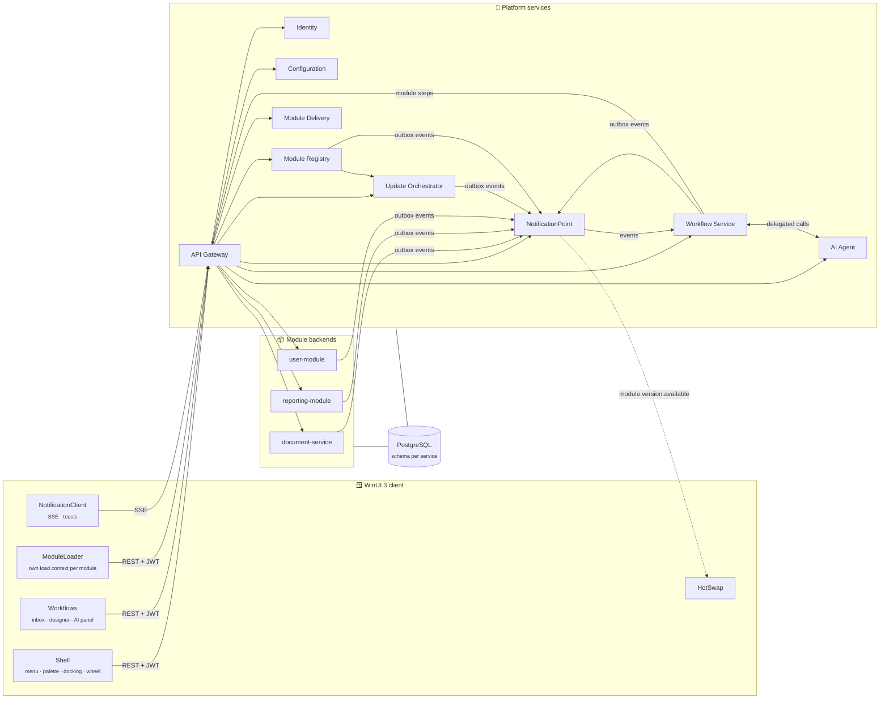
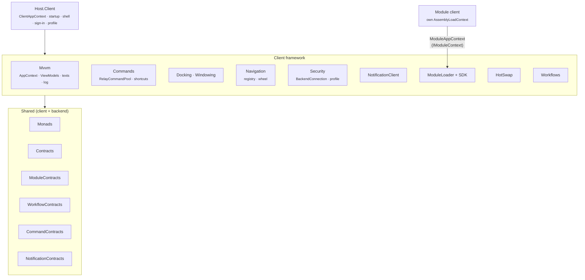
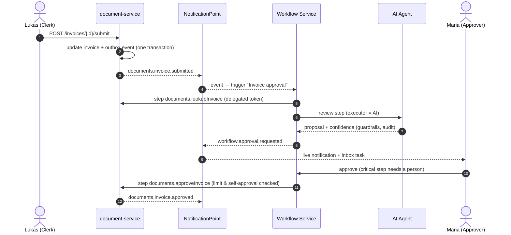
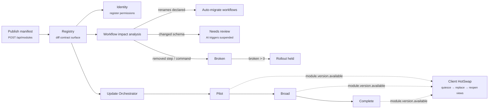

<div align="center">


# Golden Hive

**A modular, server-driven enterprise framework for WinUI 3 — with hot-swappable modules,
user-designed workflows and an AI agent that works within guardrails.**

[](https://dotnet.microsoft.com/)
[](https://learn.microsoft.com/windows/apps/winui/winui3/)
[](https://learn.microsoft.com/windows/apps/windows-app-sdk/)
[](Deployment/Docker/docker-compose.yml)
[](Deployment/Docker/database)
[](LICENSE)

[Features](#-features) ·
[Screenshots](#-screenshots) ·
[Architecture](#-architecture) ·
[Quick start](#-quick-start) ·
[Build a module](#-build-your-own-module) ·
[Workflows](#-integrate-your-module-with-workflows)

</div>

---

Golden Hive is a long-running Windows desktop host that **loads its features from the server at runtime**.
Every feature is a *module*: a WinUI client part, an ASP.NET Core backend in its own container and a manifest that
describes its commands, views, events and workflow steps. Users get the modules (and versions) the server assigns
to them. New versions are rolled out in stages and **swapped into the running app**. Before a new version goes out,
the server checks which workflows it would break.

## ✨ Features

| | |
|---|---|
| 🧩 **Runtime modules** | Each module client runs in its own `AssemblyLoadContext`, signed packages (SHA-256 + ECDSA), dependency resolution, compatibility rules, offline development modules |
| 🔁 **Hot-swap & staged rollouts** | Pilot → Broad → Complete rollouts per user group; running modules are quiesced (running commands drained or cancelled) and replaced without a restart, with rollback |
| 🧭 **Workflows designed in the app** | Input, choice, review, approval, module steps, commands, sub-workflows, wait-for-event; triggers on events, commands, schedules and conditions; a safe expression language |
| 🤖 **AI agent with guardrails** | Offline rules provider or any OpenAI-compatible endpoint; kill switch, autonomy levels, confidence thresholds, daily limits, loop detection, approvals for critical steps, full audit |
| 🛡️ **Impact analysis** | Every module update is diffed against its contract surface; workflows are auto-migrated, flagged for review or reported as broken, and broken workflows hold the rollout |
| 🔔 **Live notifications** | Transactional outbox → NotificationPoint → server-sent events with catch-up after reconnect, in-app notification centre, Windows toasts, optional WNS push |
| 🪟 **Desktop shell** | Dockable and floating tool windows that remember their monitor, command palette (`Ctrl+Shift+P`), navigation wheel (`Ctrl+Tab`), keyboard shortcuts you can change, responsive size classes, English/German |
| 👤 **Identity & profile** | JWT sign-in, roles and permissions (checked again on the server), delegated tokens for the engine/AI, profile pictures, password change |
| 🐳 **One-command backend** | 12 services with Docker Compose, PostgreSQL schemas per service, demo tenant with users, documents, invoices, reports and workflows |
| λ **Functional core** | `Result`, `Option`, `Validation` and `Error` from the database layer up to the HTTP mapper; error messages arrive as text keys and are translated in the client |

## 📸 Screenshots

> The images below are **illustrations** drawn from the actual views (layout, texts and demo data match the app).
> Real screenshots will replace them — see [docs/images](docs/images).

<table>
  <tr>
    <td width="50%"></td>
    <td width="50%"></td>
  </tr>
  <tr>
    <td align="center"><b>Shell</b> — navigation, documents overview, AI agent tool window</td>
    <td align="center"><b>Workflow inbox</b> — AI proposal, generated review form, history</td>
  </tr>
  <tr>
    <td width="50%"></td>
    <td width="50%"></td>
  </tr>
  <tr>
    <td align="center"><b>Reports</b> — parameter form, chart, table, CSV export</td>
    <td align="center"><b>Profile</b> — picture, roles, limits, password, sign-out</td>
  </tr>
</table>

## 🏗️ Architecture

### System overview



- **Every request goes through the gateway.** Routes to platform services are static; module routes come from the
  registry (`manifest.backend.route`) and are picked up at runtime. `/internal/*` endpoints are never routed. They are
  for service-to-service calls with an internal key.
- **Events are transactional.** A use case writes its data and its event into the same transaction (outbox). A
  dispatcher forwards events to the NotificationPoint, which stores them with a sequence number, streams them to
  clients and passes them to subscribers such as the workflow service.
- **The workflow engine never bypasses a module.** Module steps are HTTP calls through the gateway, made with a
  short-lived *delegated* token of the user the workflow runs as. Permissions, validation and audit are the same as
  for a click in the UI.

### Client composition



The host's `ClientAppContext` is the composition root and implements `IModuleHost`. Each loaded module gets a
`ModuleAppContext` that forwards to the host and **tracks everything the module registers** (views, commands,
menu groups, icons, texts, event subscriptions). Unloading a module removes all of it in one call.

### Reference flow: invoice approval



### Module update with impact analysis and hot-swap



More background: [ARCHITECTURE.md](ARCHITECTURE.md).

## 🚀 Quick start

### 1. Backend (Docker)

```powershell
cd Deployment\Docker
copy .env.example .env          # optional: secrets, port, AI provider
docker compose up -d --build
docker compose ps               # wait until every service is "healthy"
```

| | |
|---|---|
| Gateway | <http://localhost:8080> (`GOLDENHIVE_PORT`) — the only published service port |
| PostgreSQL | `localhost:5433`, database/user `goldenhive`, password from `.env` |
| Reset | `docker compose down -v` — drops the database and package volumes (do this after pulling schema changes) |

<details>
<summary>Check the backend without the client</summary>

```powershell
$login = Invoke-RestMethod -Method Post http://localhost:8080/api/identity/login -ContentType application/json `
    -Body '{"userName":"admin","password":"GoldenHive!2026"}'
Invoke-RestMethod http://localhost:8080/api/documents/stats -Headers @{ Authorization = "Bearer $($login.accessToken)" }
```
</details>

### 2. Client

Requirements: Visual Studio 2022/2026 with the *WinUI application development* workload, .NET 10 SDK,
Windows App SDK 1.8 or later.

1. Open `GoldenHiveFramework.slnx` and select **x64** (or ARM64/x86).
2. Run `GoldenHive.NET.WinUI.Framework.Host.Client` (F5). Building the host also builds the module clients and copies
   them next to the exe as *development modules*.
3. Sign in at `http://localhost:8080` with **`admin` / `GoldenHive!2026`**.

### Demo users

All passwords: **`GoldenHive!2026`**

| User | Role | Good for |
|---|---|---|
| `admin` | Administrator | everything: AI kill switch, publishing modules (rollout pilot group) |
| `maria.huber` | Approver | approving invoices up to 10,000 EUR (rollout pilot group) |
| `elena.rossi` | Approver + Analyst | approving up to 50,000 EUR, running reports |
| `lukas.berger` | Clerk | capturing and submitting invoices |
| `sophie.wagner` | Analyst | reports |
| `david.novak` | Viewer | read-only access |
| `tom.fischer` | Clerk | a **deactivated** account (sign-in is refused) |

### Things to try

- **Invoice approval** — as `lukas.berger` create an invoice in *Documents → Invoices* and submit it. The workflow
  starts by itself and the AI agent pre-checks it (the rules provider hands amounts above 20,000 EUR to a person).
  The task then appears in the inbox of `maria.huber` or `elena.rossi`.
- **Two windows, live** — sign in as two users side by side and watch notifications, inbox and lists update.
- **Breaking module update** — publish
  [`demo-updates/document-management-1.1.0.json`](Deployment/ModulePackages/demo-updates) and open
  *Workflows → Workflow impact*. You will see auto-migrated workflows, workflows that need review and broken
  workflows, and the rollout is held.
  <details><summary>Publish the demo update</summary>

  ```powershell
  $h = @{ Authorization = "Bearer $($login.accessToken)" }
  $manifest = Get-Content Deployment\ModulePackages\demo-updates\document-management-1.1.0.json -Raw | ConvertFrom-Json
  Invoke-RestMethod -Method Post http://localhost:8080/api/modules -Headers $h -ContentType application/json `
      -Body (@{ manifest = $manifest; channel = 'stable' } | ConvertTo-Json -Depth 32)
  ```
  </details>

- **Profile** — click your name in the top right corner to change your picture or password.

## 📁 Repository layout

```
GoldenHiveFramework/
├─ Shared/        Monads + wire contracts used by client and backend
├─ Client/        WinUI framework libraries and the host app (Host.Client)
├─ Backend/       Backend.Core + platform services (gateway, identity, registry, delivery, …)
├─ Modules/
│  ├─ ModuleClient.targets      shared build settings of module clients
│  ├─ DocumentManagement/       manifest.json · Contracts/ · Backend/ · Client/
│  ├─ Reporting/
│  └─ UserManagement/
├─ Deployment/
│  ├─ Docker/                   docker-compose.yml · .env.example · database/*.sql
│  └─ ModulePackages/           pack-modules.ps1 · demo-updates/
└─ docs/images/                 logo and UI illustrations
```

## 🧩 Build your own module

A module consists of four parts. As a running example, this section builds a small **Inventory** module
(`inventory`, prefix `inventory`).

```
Modules/Inventory/
├─ manifest.json            identity, client & backend info, permissions, contract surface
├─ Contracts/InventoryApi.cs  wire types – compiled into BOTH backend and client
├─ Backend/                 ASP.NET Core service (Docker)
└─ Client/                  WinUI module (loaded at runtime)
```

> Copy one of the existing modules as a starting point — `Reporting` is the smallest one,
> `DocumentManagement` the most complete (events, workflow steps, lookups, templates).

### 1 — Manifest

```jsonc
{
  "moduleId": "inventory",
  "version": "1.0.0",
  "displayName": "inventory:module.name",
  "icon": "inventory.home",
  "minHostVersion": "1.0.0",
  "contractsVersion": 1,
  "prefix": "inventory",                     // TextKeys, commands, icons, permissions
  "client": {
    "entryAssembly": "GoldenHive.NET.Modules.Inventory.Client.dll",
    "entryType": "GoldenHive.NET.Modules.Inventory.Client.InventoryModule",
    "viewMode": "codeOnly",                  // views built in code → hot-swappable
    "hotSwap": "supported"
  },
  "backend": { "service": "http://inventory-service:8080", "apiVersion": "v1", "route": "/api/inventory" },
  "permissions": ["inventory.view", "inventory.edit"],
  "dependencies": [{ "moduleId": "user-management", "versionRange": ">=1.0.0 <3.0.0" }],
  "languages": ["en", "de"],
  "contractSurface": {
    "backendApiVersion": "v1",
    "commands": [], "inputSchemas": [], "stepTypes": [], "events": [], "migrations": []
  }
}
```

The `contractSurface` is what workflows can depend on. It is covered in the
[workflow section](#-integrate-your-module-with-workflows).

### 2 — Contracts

Plain records shared by backend and client. Both projects link them with
`<Compile Include="..\Contracts\**\*.cs" LinkBase="Contracts" />`, so there is one wire format.

```csharp
namespace GoldenHive.NET.Modules.Inventory.Contracts;

public static class InventoryPermissions
{
    public const string View = "inventory.view";
    public const string Edit = "inventory.edit";
}

public sealed record StockItemDto(Guid Id, string Sku, string Name, int Quantity, int ReorderLevel)
{
    public int RowVersion { get; init; } = 1;
}

public sealed record AdjustStockRequest(int Delta, string Reason, int RowVersion);
```

### 3 — Backend service

A minimal-API service on top of `Backend.Core`. Core provides hosting defaults, JWT auth, the correlation ID,
health endpoints, ADO.NET/Npgsql access, the outbox, the audit log and the `Result` → HTTP mapping.

```csharp
var builder = WebApplication.CreateBuilder(args);
builder.AddGoldenHiveDefaults("inventory-service");
builder.Services.AddSingleton<StockRepository>();
builder.Services.AddScoped<AdjustStock>();
builder.Services.AddScoped<WorkflowSteps>();

var app = builder.Build();
app.UseGoldenHiveDefaults();

var api = app.MapApi("/api/inventory");                 // requires a signed-in user
api.MapGet("/", (StockRepository repo, RequestContext ctx, CancellationToken ct) =>
    Steps.Authorize(ctx.User, InventoryPermissions.View).BindAsync(_ => repo.ListAsync(ctx.User.TenantId, ct)).ToHttp());
api.MapPost("/{id:guid}/adjust", (Guid id, AdjustStockRequest request, AdjustStock useCase, CancellationToken ct) =>
    useCase.ExecuteAsync(id, request, ct).ToHttp());
api.MapPost("/workflow-steps/{stepType}", (string stepType, JsonObject inputs, WorkflowSteps steps, CancellationToken ct) =>
    steps.ExecuteAsync(stepType, inputs, ct).ToHttp());

app.Run();
```

Use cases are railway pipelines: **validate → authorize → load → decide → persist + event (one transaction) → project**.

```csharp
public sealed class AdjustStock(StockRepository repo, Db db, OutboxWriter outbox, AuditLog audit, RequestContext context)
{
    public Task<Result<StockItemDto>> ExecuteAsync(Guid id, AdjustStockRequest request, CancellationToken ct) =>
        Steps.Authorize(context.User, InventoryPermissions.Edit)
            .BindAsync(_ => db.InTransactionAsync(session =>
                repo.FindAsync(session, id, ct)
                    .Bind(item => Decide(item, request))                               // pure business rule
                    .BindAsync(item => repo.UpdateAsync(session, item, request.RowVersion, ct).Map(_ => item))
                    .TapAsync(item => item.Quantity <= item.ReorderLevel
                        ? outbox.AddAsync(session, outbox.Create("inventory.stock.low", Payload(item),
                              NotificationAudience.WithPermission(InventoryPermissions.Edit)) with
                          {
                              Title = "inventory:notification.stockLow",
                              NavigationTarget = "inventory.items",
                              NavigationParameter = item.Id.ToString(),
                          }, ct)
                        : Task.FromResult(Result.Success()))
                    .TapAsync(item => audit.WriteAsync(session, context.User, "stock.adjusted", "item", item.Id.ToString(), ct: ct)), ct: ct));

    private static Result<StockItemDto> Decide(StockItemDto item, AdjustStockRequest r) =>
        item.Quantity + r.Delta < 0
            ? Error.Conflict("inventory.stock.negative", "inventory:stock.negative")   // TextKey → translated in the client
            : item with { Quantity = item.Quantity + r.Delta };
}
```

Then wire it into the deployment:

| Where | What |
|---|---|
| `Deployment/Docker/database/05-inventory.sql` | `create schema inventory;` + tables (+ demo data). Init scripts run in file-name order on an empty volume |
| `Modules/Inventory/Backend/Dockerfile` | copy one of the module Dockerfiles (multi-stage, non-root, health check) |
| `Deployment/Docker/docker-compose.yml` | `inventory-service: { <<: *service, build: { context: ../.., dockerfile: Modules/Inventory/Backend/Dockerfile } }` |
| `GoldenHiveFramework.slnx` | add the backend and client projects |

You don't need to configure a gateway route: the gateway reads `backend.route` → `backend.service` from the registry
once the manifest is published.

### 4 — Client module

The client project imports the shared build settings. These reference the framework with `Private=false` (the host
provides it at runtime), link the contracts, and copy the dll and manifest to `artifacts/modules/<id>/` after every
build:

```xml
<Project Sdk="Microsoft.NET.Sdk">
  <PropertyGroup>
    <TargetFramework>net10.0-windows10.0.26100.0</TargetFramework>
    <RootNamespace>GoldenHive.NET.Modules.Inventory.Client</RootNamespace>
    <UseWinUI>true</UseWinUI>
    <!-- … same platform settings as the other module clients … -->
  </PropertyGroup>
  <Import Project="..\..\ModuleClient.targets" />
</Project>
```

The entry point registers everything through the SDK. All of it is removed automatically when the module unloads
or is swapped:

```csharp
public sealed class InventoryModule : ModuleEntryPoint
{
    protected override void OnInitialize()
    {
        Texts("en", InventoryTexts.English);                 // keys without prefix: "view.items.label", …
        Texts("de", InventoryTexts.German);
        Icon("home", "E7B8");                                // Segoe Fluent glyph (or "image:icon.png")

        View<StockListViewModel>("inventory.items", "inventory:view.items", "inventory.home",
            vm => new StockListView(vm), home: true, permission: InventoryPermissions.View);

        MenuGroup("inventory:menu", order: 50);              // own main-menu entry
        NavigationGroup("inventory:module", order: 50);      // group in the navigation tree

        Command("inventory.adjust", "inventory:cmd.adjust", "inventory.home",
            p => Adjust(p), permission: InventoryPermissions.Edit,
            placements: new CommandPlacement[] { InMenu(0, 0) },
            workflowCapable: true, aiAllowed: true);         // usable from workflows / by the AI agent
    }
}
```

ViewModels derive from `ModuleViewModel`. It provides the module's API client (`Api` = `/api/inventory`),
module-scoped texts (`T("view.items.label")`), permission checks (`Has(...)`) and `RunAsync`, which shows busy state
and turns a failed `Result` into a translated error text:

```csharp
public sealed class StockListViewModel : ModuleViewModel
{
    private IReadOnlyList<StockItemDto> _items = [];
    public IReadOnlyList<StockItemDto> Items { get => _items; private set => SetProperty(ref _items, value); }

    protected override void OnCreated() =>
        Module.Subscribe("inventory.*", e => AppContext.Dispatcher?.Run(() => _ = LoadAsync()));   // live updates

    public override void OnNavigatedTo(object? parameter) => _ = LoadAsync();

    public Task<bool> LoadAsync() =>
        RunAsync(ct => Api.GetAsync<IReadOnlyList<StockItemDto>>(string.Empty, ct), items => Items = items);
}
```

Views are `UserControl`s built in code with `UiKit` (buttons, cards, fields, messages, busy ring, `Watch` for
property changes), `DataList<T>`, `InputForm` (generated from an `InputSchema`) and `SimpleChart`. Code-only views
need no XAML metadata provider, which is what makes a module **hot-swappable**.

Finally, add the client project to the host so it is built and deployed as a development module:

```xml
<!-- Client/GoldenHive.NET.WinUI.Framework.Host.Client/…Host.Client.csproj -->
<ProjectReference Include="..\..\Modules\Inventory\Client\GoldenHive.NET.Modules.Inventory.Client.csproj"
                  ReferenceOutputAssembly="false" Private="false" />
```

### 5 — Publish and roll out

```powershell
# build + zip; upload the package (hashed and signed by ModuleDelivery); publish the manifest to the registry
.\Deployment\ModulePackages\pack-modules.ps1 -Module inventory -Upload -Publish -Password 'GoldenHive!2026'
```

Publishing registers the module's permissions, runs the workflow impact analysis and starts a rollout. Clients
with the module assigned download the signed package. Users who already have it running get it swapped in place.
To release a new version, raise `version` in the manifest and run the script again.

## 🔗 Integrate your module with workflows

Workflows can use **only what a module declares in its `contractSurface`**. That declaration is the contract that
the impact analysis checks whenever the module changes.

| Building block | Declare in the manifest | Implement in the module | Used in a workflow as |
|---|---|---|---|
| **Step type** — a headless operation | `stepTypes[]` with `id`, `input` schema, `outputs`, `endpoint` | `POST /api/<module>/workflow-steps/{stepType}` | `kind: moduleStep`, `stepTypeId` |
| **Command** — a user action | `commands[]` with `workflowCapable`, `aiAllowed`, `endpoint` | `Command(..., workflowCapable: true)` in the client + the endpoint | `kind: command`, `commandId`; or a **command trigger** |
| **Event** — something happened | `events[]` with `type`, `payloadVersion` | `outbox.Create(type, payload, audience)` in a use case | **event trigger** with filter and payload mapping |
| **Input schema** — a form | `inputSchemas[]` with fields, types, lookups | lookup endpoints for `entityRef` fields | `kind: input / review`, rendered by `InputForm` |

### Step types

```jsonc
"stepTypes": [{
  "id": "inventory.reorder",
  "version": 1,
  "title": "inventory:step.reorder",
  "headless": true,
  "endpoint": "/api/inventory/workflow-steps/inventory.reorder",
  "input": { "schemaId": "inventory.reorder", "fields": [
      { "name": "itemId",   "type": "text",   "label": "inventory:field.item",     "required": true },
      { "name": "quantity", "type": "number", "label": "inventory:field.quantity", "required": true, "min": 1 } ] },
  "outputs": ["orderId", "expectedOn"]
}]
```

The endpoint receives the step inputs as a JSON object and returns the outputs. The engine calls it **as the user
the workflow runs as** (with a delegated token), so reuse the same use cases as the UI:

```csharp
public sealed class WorkflowSteps(PlaceReorder reorder)
{
    public Task<Result<JsonObject>> ExecuteAsync(string stepType, JsonObject inputs, CancellationToken ct) => stepType switch
    {
        "inventory.reorder" => reorder.ExecuteAsync(Guid.Parse(inputs["itemId"]!.ToString()), (int)inputs["quantity"]!, ct)
            .Map(order => new JsonObject { ["orderId"] = order.Id.ToString(), ["expectedOn"] = order.ExpectedOn.ToString("O") }),
        _ => Task.FromResult(Result<JsonObject>.Failure(Error.NotFound("inventory.stepType.unknown", "workflow:stepType.unknown"))),
    };
}
```

### Events and triggers

Declare the events your module emits (`"events": [{ "type": "inventory.stock.low" }]`) and write them through the
outbox in the same transaction as the change (see `AdjustStock` above). A workflow can then start on the event:

```jsonc
{
  "name": "Reorder low stock",
  "startStepId": "confirm",
  "triggers": [{
    "kind": "event",
    "eventType": "inventory.stock.low",
    "filter": "payload.quantity < payload.reorderLevel",
    "payloadMapping": { "itemId": "payload.itemId", "quantity": "payload.reorderLevel * 2" },
    "deduplicationKey": "payload.itemId",
    "executor": "ai",                                 // or "human"
    "runAs": "10000000-0000-0000-0000-000000000003"   // user id; default: the workflow owner
  }],
  "aiPolicy": { "autonomy": "approveCritical", "approvers": ["inventory.edit"], "requiredConfidence": 0.7 },
  "steps": [
    { "id": "confirm", "kind": "approval", "title": "Confirm the reorder", "approvers": ["inventory.edit"] },
    { "id": "order",   "kind": "moduleStep", "title": "Place the order", "stepTypeId": "inventory.reorder", "critical": true,
      "parameters": { "itemId": "vars.itemId", "quantity": "vars.quantity" } }
  ],
  "transitions": [
    { "from": "confirm", "to": "order", "condition": "last.decision == 'approve'" },
    { "from": "confirm", "to": "end" },
    { "from": "order",   "to": "end" }
  ]
}
```

Other trigger kinds:
- `command`: run whenever a user executes a `workflowCapable` command.
- `schedule`: run on a schedule, e.g. `every:30` (minutes) or `daily:07:30` (UTC).
- `condition`: poll a module API (`conditionUrl`) that returns a JSON boolean; the workflow starts when it turns
  `true`.
- `manual`: start from the inbox or the designer.

**Expressions** (filters, conditions, parameters) use a small, side-effect-free language:

- **Values you can read:** `vars.*`, `payload.*`, `steps.<id>.<output>`, `last.*`.
- **Operators:** comparisons and `&& || !`.
- **Functions:** `coalesce`, `isEmpty`, `len`, `lower`, `upper`, `trim`, `contains`, `startsWith`, `endsWith`,
  `round`, `abs`, `min`, `max`, `number`, `text`.

The designer validates expressions before it saves a workflow.

### Shipping workflows with a module

Workflows are data. Create them in the *Workflows* view (edit as JSON or record your clicks with *Record*), or post
them to the workflow service. Set `origin: "moduleTemplate"` and `owningModule` so they are shown as templates of
your module:

```powershell
Invoke-RestMethod -Method Post http://localhost:8080/api/workflows -Headers $h -ContentType application/json `
    -Body (@{ definition = (Get-Content reorder.workflow.json -Raw | ConvertFrom-Json); publish = $true } | ConvertTo-Json -Depth 32)
```

### Letting the AI agent work on your steps

- Mark commands `aiAllowed: true` and use **review** steps with `tools` (step types the AI may call to fetch data).
- The workflow's `aiPolicy.autonomy` decides how much the agent may do on its own:
  - `off`: the AI never runs this workflow.
  - `suggest`: the AI pre-fills inputs; a person executes every step.
  - `approveEachStep`: the AI proposes each step; a person approves it.
  - `approveCritical`: the AI runs; steps marked `critical: true` wait for a person.
  - `autonomous`: the AI runs every step it is allowed to; `approval` steps still need a person.
- Every AI decision is written to the audit trail with its reasoning and confidence. `admin` can switch the agent
  off globally.

### Changing a module without breaking workflows

When you publish a new version, the registry diffs the contract surface. Declare renames so that workflows are
**migrated automatically** instead of breaking:

```jsonc
"migrations": [
  { "kind": "stepType",    "from": "inventory.reorder", "to": "inventory.placeOrder" },
  { "kind": "inputSchema", "from": "inventory.reorder", "to": "inventory.placeOrder",
    "fieldRenames": { "quantity": "amount" } }
]
```

| Change | Result |
|---|---|
| Renames declared in `migrations` | workflows are **auto-migrated** (new workflow version, expressions rewritten) |
| New required input field, changed type | **needs review** — AI triggers suspended, running instances paused |
| Step type / command / event removed without a migration | **broken** — the rollout is held until fixed (or forced) |

Keep `stepTypes[].version` and `events[].payloadVersion` up to date. Additive changes (a new optional field, a new
output, a new event) are always safe.

## ⚙️ Configuration

| Setting | Where |
|---|---|
| Secrets, port, AI provider (`rules` / `openai`), review limit, WNS | `Deployment/Docker/.env` |
| Static gateway routes of the platform services | `Backend/…ApiGateway/appsettings.json` |
| Client server URL, remembered user | sign-in dialog (`Connection.json` in the app's roaming data, the token in the Windows credential locker) |

Backend services also run without Docker (`dotnet run --project …`). Set `ConnectionStrings__Database`,
`GoldenHive__JwtKey` and `GoldenHive__InternalKey`; [`docker-compose.yml`](Deployment/Docker/docker-compose.yml)
shows all variables.

## 🤝 Contributing

Issues and pull requests are welcome. Please keep to the conventions of the code base:

- `Result`/`Validation` instead of exceptions.
- Text keys (`scope:key`) for every user-visible message, in English and German.
- Code-only module views.
- One transaction for data plus its outbox event.

## 📄 License

Copyright 2026 ZenoxArt. Licensed under the [Apache License, Version 2.0](LICENSE); see also [NOTICE](NOTICE).
